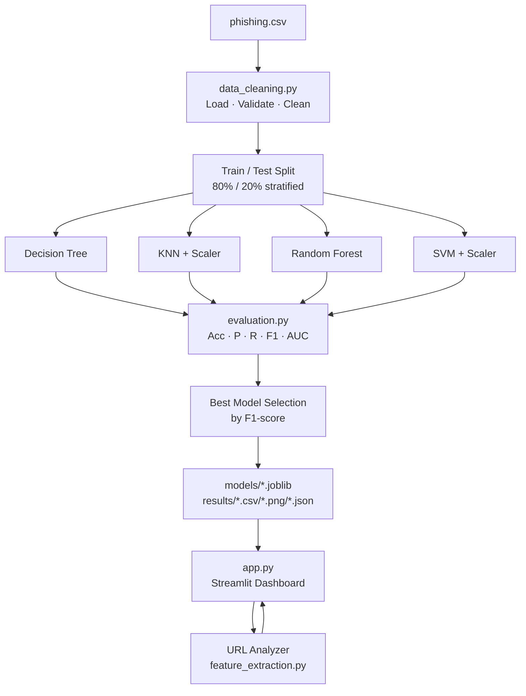

# PhishGuard

**ML-Based Phishing Website Detection System**

A machine learning project that classifies website URLs as *Potentially Phishing* or *Likely Legitimate* using four scikit-learn classifiers trained on the UCI Phishing Websites Dataset.

---

## Problem Statement

Phishing websites impersonate legitimate organisations to steal credentials and sensitive data. Traditional blacklist approaches cannot keep pace with the rapid creation of new phishing domains. This project applies machine learning to detect phishing patterns from pre-extracted URL and website features.

---

## Features

- **Four ML classifiers**: Decision Tree, K-Nearest Neighbors, Random Forest, Support Vector Machine
- **Complete evaluation**: Accuracy, Precision, Recall, F1-score, ROC-AUC, training time
- **URL Analyzer**: Enter a URL and receive a classification with extracted feature details
- **Interactive dashboard**: Streamlit-based 5-page web application
- **Data insights**: Class distribution, missing values, preprocessing summary
- **Reproducible results**: Fixed random seeds, stratified splits, artifact persistence

---

## Technology Stack

| Tool | Purpose |
|------|---------|
| Python 3 | Core language |
| pandas, NumPy | Data processing |
| scikit-learn | ML pipelines and evaluation |
| Matplotlib, Seaborn | Visualisation |
| Streamlit | Web interface |
| Joblib | Model persistence |

---

## Dataset Attribution

- **Name**: Phishing Websites Dataset
- **Source**: [UCI Machine Learning Repository](https://archive.ics.uci.edu/dataset/327/phishing+websites)
- **Donated by**: Rami Mohammad, Fadi Thabtah, Lee McCluskey (2015)
- **DOI**: 10.24432/C51W2X
- **License**: Creative Commons Attribution 4.0 International (CC BY 4.0)
- **Instances**: 11,055 | **Features**: 30 | **Classes**: Phishing (−1), Legitimate (1)

---

## Project Structure

```
PhishGuard/
├── app.py                  # Streamlit web application
├── train.py                # Model training script
├── requirements.txt        # Python dependencies
├── README.md
├── .gitignore
├── data/
│   └── README.md           # Dataset download instructions
├── src/
│   ├── __init__.py
│   ├── data_cleaning.py    # Dataset loading, validation, cleaning
│   ├── feature_extraction.py  # URL → feature vector for live inference
│   └── evaluation.py       # Metrics, plots, CSV/JSON persistence
├── models/
│   └── *.joblib            # Saved model pipelines (generated)
├── results/
│   ├── model_comparison.csv
│   ├── confusion_matrices.png
│   ├── roc_curves.png
│   ├── f1_comparison.png
│   └── *.json              # Dataset info, best model, cleaning summary
├── notebooks/
│   └── exploration.ipynb   # Exploratory analysis notebook
└── report/
    └── report_outline.md   # 10-page report structure
```

---

## Architecture



---

## Installation

```bash
git clone https://github.com/<your-username>/PhishGuard.git
cd PhishGuard
python -m venv venv
source venv/bin/activate        # Windows: venv\Scripts\activate
pip install -r requirements.txt
```

---

## Dataset Setup

See [`data/README.md`](data/README.md) for detailed download instructions.

**Quick option (Kaggle mirror):**
1. Download `phishing.csv` from [Kaggle](https://www.kaggle.com/datasets/eswarchandt/phishing-website-detector)
2. Place it at `data/phishing.csv`

**UCI option:**
1. Download from [UCI Repository](https://archive.ics.uci.edu/dataset/327/phishing+websites)
2. Convert the `.arff` file to CSV

---

## Training

```bash
python train.py
```

This will:
1. Load and validate `data/phishing.csv`
2. Clean and preprocess the data
3. Train all four model pipelines
4. Evaluate on the held-out test set
5. Save artifacts to `models/` and `results/`

---

## Launch Application

```bash
streamlit run app.py
```

Open [http://localhost:8501](http://localhost:8501) in your browser.

---

## Model Comparison

All models are evaluated on the **same held-out 20% test set**.

**Selection criterion:** F1-score on the phishing class (−1), with ROC-AUC as tiebreaker.

*Results below will be populated after running `python train.py`:*

| Model | Accuracy | Precision | Recall | F1-Score | ROC-AUC | Train (s) |
|-------|----------|-----------|--------|----------|---------|-----------|
| **Decision Tree** | **0.9477** | **0.9551** | 0.9444 | **0.9497** | 0.9666 | 0.003 |
| K-Nearest Neighbors | 0.9128 | 0.9213 | 0.9111 | 0.9162 | 0.9766 | 0.002 |
| Random Forest | 0.9448 | 0.9351 | **0.9611** | 0.9479 | **0.9891** | 0.173 |
| Support Vector Machine | 0.9331 | 0.9337 | 0.9389 | 0.9363 | 0.9868 | 0.090 |

> Evaluated on UCI Phishing Websites Dataset — 1716 instances (after deduplication), 20% held-out test set, stratified split, `random_state=42`.
> Positive class = −1 (Phishing) for Precision, Recall, F1.

**Best model**: **Decision Tree** (F1=0.9497) — selected by F1-score on phishing class.

---

## Limitations

1. Many dataset features require live website inspection; the URL Analyzer approximates these conservatively from the URL string only.
2. Training data is from 2015; modern phishing techniques may not be fully represented.
3. Binary classification only — does not distinguish phishing subtypes.
4. No live network requests are made; this is intentional for safety.

---

## Future Improvements

- Integrate optional live feature extraction (DNS, SSL, WHOIS) with user consent.
- Add XGBoost / LightGBM for comparison against the baseline models.
- Use SHAP for per-prediction feature explanations.
- Retrain on a continuously updated phishing URL dataset.
- Lower the decision threshold for higher recall in high-risk settings.

---

## Screenshots

*Screenshots will be added after the application is launched and trained.*

---

## Deployment (Streamlit Community Cloud)

1. Push the repository to GitHub (excluding `data/*.csv` — add manually or use DVC).
2. Commit `models/*.joblib` and `results/` files, or add a startup script to regenerate them.
3. Connect the repository at [share.streamlit.io](https://share.streamlit.io).
4. Set main file to `app.py`.

---

## License

Code: MIT License.
Dataset: [CC BY 4.0](https://creativecommons.org/licenses/by/4.0/) — cite Mohammad et al. (2015).

---

## Citation

If you use this project or the dataset, please cite:

```
R. M. Mohammad, F. Thabtah, L. McCluskey.
"Phishing Websites Features."
UCI Machine Learning Repository, 2015.
DOI: 10.24432/C51W2X
```
